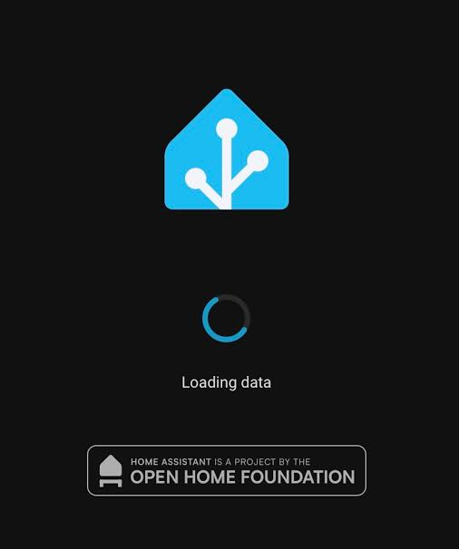

# Hide OHF Badge

A Home Assistant app that replaces the Foundation logo on the login and splash
screens with a transparent SVG. Covers light and dark variants.

## Which logo does it hide?

The app hides the **Open Home Foundation badge at the bottom** of the splash
and login screens. The main Home Assistant logo remains visible.

## Install through the dashboard

1. Open the button above, or **Settings → Apps → Install app → menu → Repositories**.
2. Add `https://github.com/spasemice/ha-hide-ohf-badge`.
3. Find **Hide OHF Badge** and select **Install**.
4. Turn **Protection mode OFF**, then select **Start**.
5. Leave **Start on boot ON** and **Watchdog ON**.
6. Select **Open Web UI** for the verified result and last check time.

The first installation builds a Docker image on the Home Assistant host.
There is no separate image to publish and no SSH setup for users.
Home Assistant OS or a Supervisor installation on aarch64/amd64 is required.
Home Assistant Container without Supervisor cannot install apps.

## What happens after updates

The app listens for Home Assistant Core container start events. It subscribes,
checks once, replaces the two SVG files if needed, then sleeps until Core starts
again. There is no 300-second timer and no periodic SVG polling.

The process remains in memory to receive the next event. If Docker disconnects,
it reconnects with a backoff and checks once to cover a missed start event.
Watchdog checks only the app listener, never the Core files.

## Status and settings

Open Web UI shows success/errors, last check time, check count, sleeping state,
and current Info settings. The page refreshes only on request. The native
Configuration tab has no interval or runtime status fields.

| Info setting | Required value |
| --- | --- |
| Start on boot | ON; default |
| Watchdog | ON; enabled once on first start of version 1.1 or later, then user changes are respected |
| Protection mode | OFF; must be selected manually |

Docker access is powerful and is needed to change files inside Core. The app
does not grant itself a Supervisor admin/manager role or expose a LAN port.
Protection mode cannot be turned off by the app manifest.

## Backups and stopping

Original SVGs are preserved under the Home Assistant configuration folder:
`branding-backups/automatic/<sha256>/<filename>`.
Repeated checks do not rewrite already-blank files or duplicate originals.
Unexpected or missing files produce an error. The app never restarts Core.

Stop the app and disable Start on boot to stop future replacements. Uninstall
from the app page. Stopping does not restore images; restore the saved originals
or update Core. A browser may require a hard refresh after a change.

## Repository layout

- `repository.yaml` — app repository metadata
- `hide_ohf_badge/config.yaml` — app metadata, permissions, ingress and schema
- `hide_ohf_badge/Dockerfile` — source build for both supported architectures
- `hide_ohf_badge/app.py` — Core start listener and one-time default setup
- `hide_ohf_badge/patcher.py` — validated replacements and original backups
- `hide_ohf_badge/status.py` — read-only ingress status and watchdog health
- `hide_ohf_badge/icon.png` — app store icon
- `hide_ohf_badge/DOCS.md` — documentation tab
- `tests/` — patching, event, status and safety checks

## Development

Run `python3 -m unittest discover -s tests -v`.

## Restore default logos

To restore the default Home Assistant logos, stop this app and disable
**Start on boot**, or uninstall the app. The next **Home Assistant Core update**
will automatically restore the original logos. Stopping or uninstalling the app
does not restore the logos immediately.

Use **Back to app** in the status page to return to the app Info tab.
